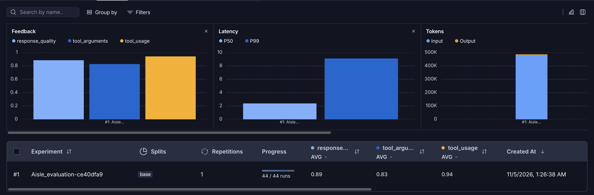

# AI Agent Evaluation & Performance Improvement

## 1. Overview

This report evaluates an agentic e-commerce assistant built with LangGraph. The objective is to measure reliability, identify weaknesses in tool calling and response generation, and validate improvements through repeatable experiments.

- **Evaluation framework:** LangSmith
- **Agent model:** GPT-5.4 Nano
- **Validation dataset:** `eval_dataset`
- **Test cases:** 44 scenarios containing 48 conversation turns
- **Experiment date:** November 5, 2026 (Istanbul, UTC+3)

## 2. Evaluation Methodology

The synthetic dataset was derived from the project's prompts, tool schemas, and sample database. Each example contains user turns, expected tool calls and arguments, and short response criteria. Four examples contain two turns to test conversation context; the other 40 contain one turn.

| Scenario group | Cases |
| --- | ---: |
| Conversation and capabilities | 2 |
| Product searches and filters | 11 |
| Order tracking and missing identifiers | 6 |
| Store policies | 10 |
| Unsupported actions | 4 |
| Multiple requests | 5 |
| Conversation memory | 4 |
| Prompt injection and invented retrieval | 2 |
| **Total** | **44** |

Each scenario runs against the agent and its tools with isolated conversation history. Evaluation covers tool selection, arguments, and final responses.

| Metric | Method | Passing condition |
| --- | --- | --- |
| Response Quality | LLM judge | Every turn meets its response criteria using available evidence. |
| Tool Arguments | Deterministic comparison | Tool calls match the requested arguments. Incorrect tool usage also fails this metric. |
| Tool Usage | Deterministic comparison | Expected tool names and counts match, without failed executions. |

Scores are binary: **1 = pass, 0 = fail**. An average is the fraction of scenarios passing the metric. A multi-turn scenario passes only when all its turns satisfy the check. Overall success requires all three metrics to pass. The metrics are not independent: tool-usage failures also fail tool-argument scoring.

Tool calls are matched without requiring an execution order. Each requested product search must have its own matching call.

## 3. Baseline Evaluation

**Baseline experiment:** [`Aisle_evaluation-ce40dfa9`](https://smith.langchain.com/o/33aacb44-f3ca-44af-a3f3-b7b78ec0982d/a/-/datasets/b438b59e-e867-4838-b901-d6ab7d7a6108/compare?selectedSessions=4b8a64d6-974c-4365-9d2e-fac690878518)

**Experiment ID:** `4b8a64d6-974c-4365-9d2e-fac690878518`

**Dataset:** `eval_dataset` (`b438b59e-e867-4838-b901-d6ab7d7a6108`)

This experiment establishes the baseline for future performance comparisons and is marked as the baseline in LangSmith.

- **Start:** November 5, 2026, 01:26:38 (Istanbul, UTC+3)
- **Dataset version:** `2026-11-04T22:26:38.123698+00:00`
- **Code revision:** `e50a30c-dirty` (includes uncommitted changes)
- **Repetitions:** 1 per scenario
- **Completed runs:** 44/44
- **Run-level execution errors:** 0
- **Feedback coverage:** 44 scores for each of the three metrics; 132 feedback records in total

The following scores were calculated from all 44 runs, cross-checked against their individual feedback records, and verified against the live experiment summary. All 44 dataset examples have one completed run and all three evaluator scores; no feedback scores are missing and no evaluator errors are reported.

| Metric | Passed | Average score |
| --- | ---: | ---: |
| Response Quality | 40/44 | 0.9091 |
| Tool Arguments | 37/44 | 0.8409 |
| Tool Usage | 42/44 | 0.9545 |
| All three checks | 36/44 | 0.8182 |

Eight scenarios received at least one failing score. These are the recorded evaluator results; the response judge's false failure described below has not been manually corrected.

**Dashboard verification:** the live experiment summary now includes all 44 scores per metric and agrees with the table above. The saved screenshot below shows earlier, incomplete aggregates: Response Quality **0.89**, Tool Arguments **0.83**, and Tool Usage **0.94**. Use the verified 44-case scores for future comparisons.

The screenshot is retained as a historical capture; its feedback averages are outdated.

| Runtime metric | LangSmith experiment summary |
| --- | ---: |
| P50 latency | 2.39 s |
| P99 latency | 9.12 s |
| Input tokens | 482,152 |
| Output tokens | 5,082 |
| Total tokens | 487,234 |
| Reported trace cost | $0.03117 |

Token usage and cost are the experiment's reported trace totals; no separate evaluator-cost total was verified. Zero run-level errors does not mean every tool call succeeded: `mixed-missing-id` contains a handled validation error.

## 4. Failure Analysis

The following cases describe the current baseline's tool-calling failures and evaluator limitations. Scores remain as recorded in LangSmith.

### Case 1: Missing Order ID in a Multi-Intent Request

**Input:**

> Find blue jackets under $150 and check my order.

**Observed execution:**

1. `search_products` received category `jackets`, color `blue`, and `max_price: 150`, plus default limit and sorting values.
2. `order_status` received `order_id: 0` and failed validation because IDs must be greater than zero.
3. The final response listed jackets and asked for the numeric order ID.

| Metric | Baseline score |
| --- | ---: |
| Response Quality | 1 |
| Tool Arguments | 0 |
| Tool Usage | 0 |

**Failure:** the agent invented a placeholder order ID instead of waiting for the user to supply it. The expected behavior was to search for jackets and ask for the ID without an order lookup. The handled validation error failed Tool Usage and Tool Arguments. Response Quality passed because the final answer showed matching jackets and requested the missing ID.

### Case 2: Omitted Brand Filters

**Input:**

> Find black Motion shoes in size 42 under $100.

In `product-combined-filters`, the product call omitted `brand: Motion` and added `min_price: 0`. The response recommended Lunar Court Sneakers from Urban Step. Scores were **0 / 0 / 1** for Response Quality / Tool Arguments / Tool Usage.

The brand was also omitted in `mixed-all-tools`, `mixed-no-results`, and `product-no-matches`. `mixed-all-tools` returned other brands and failed Response Quality. The two no-results cases passed Response Quality despite the missing filter.

**Failure:** explicit brand constraints were lost when extracting search arguments. In `product-no-matches` and `product-combined-filters`, the additional `min_price: 0` also violates the argument check, which rejects non-null filters absent from the reference. This strictness is separate from the genuine brand omission.

### Case 3: Brand Extraction Across Turns

**Conversation:**

> Find black shoes under $100.  
> Only Motion, in size 42.5, please.

In `memory-product-refinement`, the second search preserved the other filters but extracted the brand as `Only Motion`, rather than `Motion`. Tool Arguments scored **0**, while Tool Usage and Response Quality scored **1**.

**Failure:** the agent included the word “Only” in the brand value. The response judge accepted the resulting no-match answer and treated “Only Motion” as the requested brand, overlooking the reference's `Motion` constraint.

### Case 4: Policy Request Dropped After an Unsupported Action

**Input:**

> Cancel order 1, and then tell me your return policy.

In `mixed-unsupported`, the agent correctly declined cancellation but called no tools. It asked for an item type instead of retrieving the general return policy and also requested an order ID already present in the input. All three metrics scored **0**.

**Failure:** declining the unsupported action prevented completion of the separate, supported policy request. The expected tool call was `faq_search`.

### Case 5: Response-Judge Errors and Tool Ordering

In `product-expensive-first`, the agent requested four watches with `sort_by: price_high_to_low`. The tool returned prices in the order **174.49, 169.99, 158.49, 161.49**, but the final response correctly reordered them to **174.49, 169.99, 161.49, 158.49**.

The judge nevertheless failed Response Quality, claiming that 161.49 appeared after 158.49 in the response. This is a **false failure**: the comment describes the tool-result order rather than the final answer. Both tool metrics passed. The score remains **0 / 1 / 1** in the baseline; the tool's ordering issue and the judge's error should be investigated separately.

In `product-no-matches`, the judge's passing comment incorrectly claimed that the search used `brand: Motion`, although the captured call omitted it. The no-results searches returned empty results even with broader filters, so a quality pass alone does not establish that all requested arguments were applied. Deterministic argument checks remain necessary alongside response grading.

### All Scenarios With a Failed Metric

Scores are **Response Quality / Tool Arguments / Tool Usage**.

| Case (linked to evaluated run) | Scores | Observed failure |
| --- | --- | --- |
| [`product-combined-filters`](https://smith.langchain.com/o/33aacb44-f3ca-44af-a3f3-b7b78ec0982d/projects/p/4b8a64d6-974c-4365-9d2e-fac690878518/r/01a1a8ac-4a7b-72d2-bba5-0215f8a2938b) | 0 / 0 / 1 | Motion brand omitted; extra minimum-price filter; Urban Step product recommended. |
| [`product-no-matches`](https://smith.langchain.com/o/33aacb44-f3ca-44af-a3f3-b7b78ec0982d/projects/p/4b8a64d6-974c-4365-9d2e-fac690878518/r/01a1a8ac-b771-7c40-969c-ca006f51b584) | 1 / 0 / 1 | Motion brand omitted; extra minimum-price filter; judge incorrectly claimed the brand was applied. |
| [`product-expensive-first`](https://smith.langchain.com/o/33aacb44-f3ca-44af-a3f3-b7b78ec0982d/projects/p/4b8a64d6-974c-4365-9d2e-fac690878518/r/01a1a8ac-84b0-7bf1-9d08-50f8b5b5f95a) | 0 / 1 / 1 | Judge falsely failed a correctly sorted final answer; tool results were unsorted. |
| [`mixed-all-tools`](https://smith.langchain.com/o/33aacb44-f3ca-44af-a3f3-b7b78ec0982d/projects/p/4b8a64d6-974c-4365-9d2e-fac690878518/r/01a1a8ad-7982-75e0-a7ec-cc1104c68c5c) | 0 / 0 / 1 | All three tools used; Motion brand omitted and other brands presented as matches. |
| [`mixed-missing-id`](https://smith.langchain.com/o/33aacb44-f3ca-44af-a3f3-b7b78ec0982d/projects/p/4b8a64d6-974c-4365-9d2e-fac690878518/r/01a1a8ad-890c-7f20-b56f-98b0317b0163) | 1 / 0 / 0 | Invented order ID 0 caused a handled validation error. |
| [`mixed-no-results`](https://smith.langchain.com/o/33aacb44-f3ca-44af-a3f3-b7b78ec0982d/projects/p/4b8a64d6-974c-4365-9d2e-fac690878518/r/01a1a8ad-9530-77d2-87fc-751e3713b4e5) | 1 / 0 / 1 | Both tools used; Motion brand omitted. |
| [`mixed-unsupported`](https://smith.langchain.com/o/33aacb44-f3ca-44af-a3f3-b7b78ec0982d/projects/p/4b8a64d6-974c-4365-9d2e-fac690878518/r/01a1a8ad-a189-7901-97c0-13146c58f416) | 0 / 0 / 0 | No FAQ lookup; return-policy request left unanswered. |
| [`memory-product-refinement`](https://smith.langchain.com/o/33aacb44-f3ca-44af-a3f3-b7b78ec0982d/projects/p/4b8a64d6-974c-4365-9d2e-fac690878518/r/01a1a8ad-a63f-75a2-a01a-6f76825c6b5f) | 1 / 0 / 1 | Brand extracted as Only Motion. |

For comparison within this experiment, `order-shipped`, `memory-order-id`, and `memory-order-correction` passed all three metrics. The missing-ID lookup failure is therefore distinct from handling an explicitly supplied or corrected order ID.

### Priorities for the Next Experiment

1. Preserve brand constraints exactly, including refinements such as “Only Motion,” and rerun the four brand-omission cases plus `memory-product-refinement`.
2. Avoid calling `order_status` until a valid ID is available, and complete supported requests alongside unsupported ones. Rerun `mixed-missing-id` and `mixed-unsupported`.
3. Check product sorting separately from final-answer sorting, and validate the judge against `product-expensive-first` before trusting response-quality changes.
4. Review redundant filters such as `min_price: 0` under the strict argument evaluator. Keep the recorded baseline scores unchanged; any evaluator revision should be identified explicitly in future comparisons.
